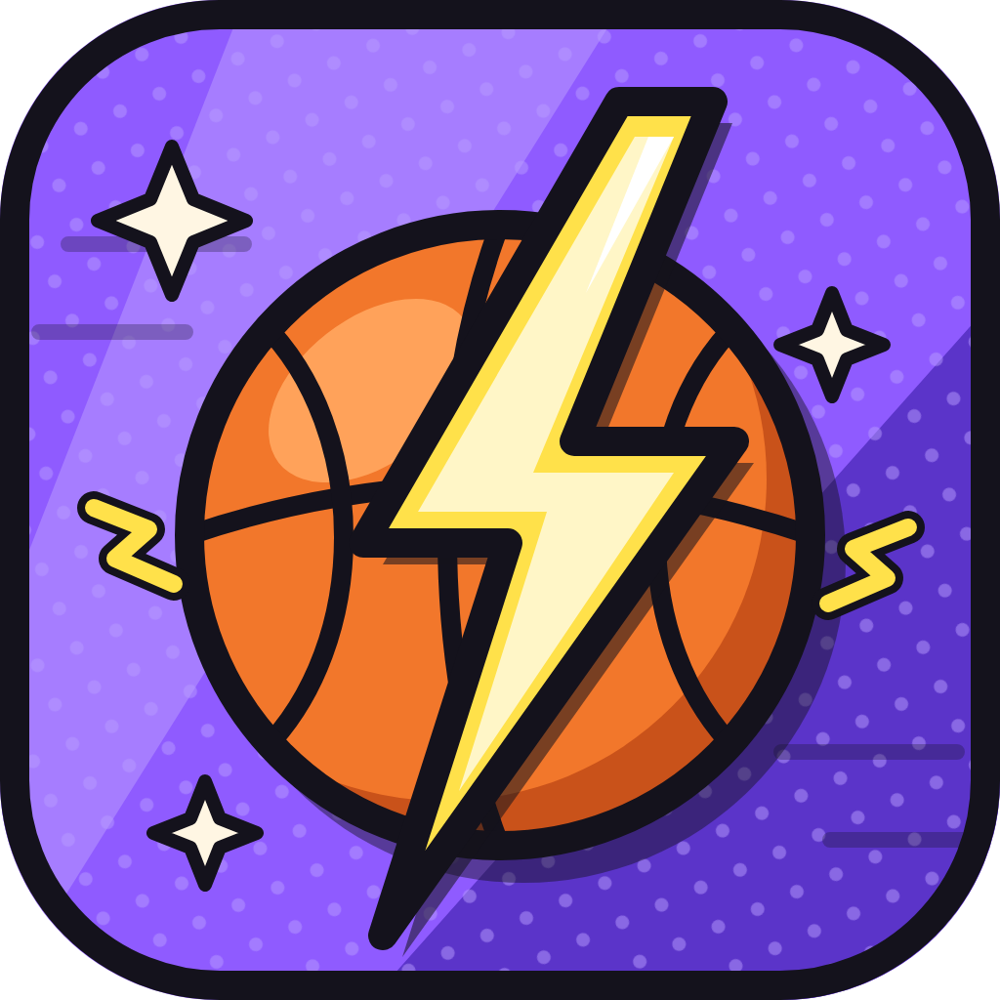

# Static

A cel-shaded 3v3 full-court street basketball game that runs in the browser. You control one player from an over-the-shoulder camera; your two teammates and the three opponents play on their own.

## Play

Open `index.html` in a browser. The page loads three.js and its fonts from a CDN, so it needs an internet connection.

To host it, turn on GitHub Pages for this repository (Settings → Pages → deploy from the `main` branch) and open the link it gives you.

## What's in it

- Full-court 3v3 in a fenced city court, first to 11, 15 or 21, with three CPU levels
- A 2.5D start screen, then a lobby with Home, Baller, Gacha and Settings tabs
- Gacha with five banners: 17 anime-style characters, plus jump shots, dribbles and dunks to pull
- Five dribble slots (stick forward, left, right, back, no stick), a separate dunk button, sprint and stamina
- Touch, keyboard and mouse, and controller support with rebindable controls and Xbox or PlayStation button names
- Frame-rate and quality settings, and a pause menu
- An update check on start: when a new build has been pushed, the game downloads it and reloads before loading in

Progress (coins, characters, moves and settings) is saved in the browser on the device you play on.

## Files

- `index.html`: the whole game in one file
- `static-icon.svg`, `static-icon.png`, `icon-192.png`, `apple-touch-icon.png`: the game icon, used for the browser tab and home-screen shortcut
